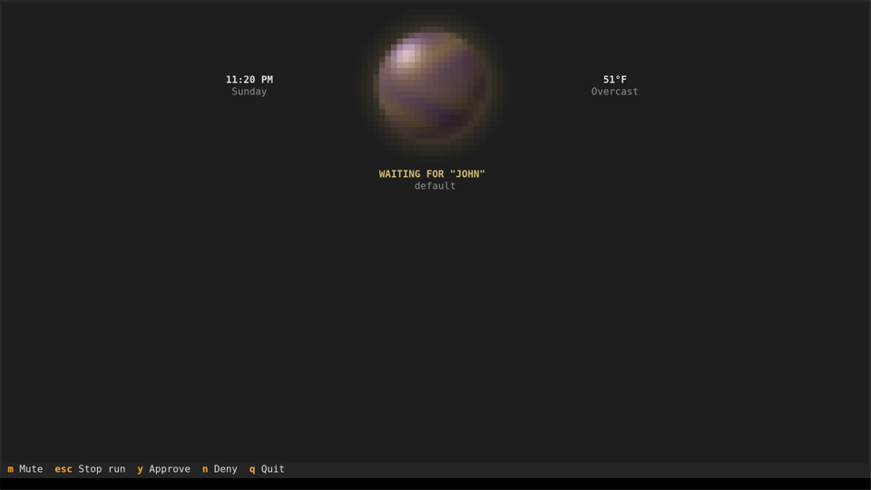

# Hermes Voice

Hermes Voice listens on the microphone, transcribes speech, and sends the text to a Hermes agent at `http://127.0.0.1:8642`. The conversation stays in the terminal. Replies are spoken aloud.



## Setup

Install [Rust](https://rustup.rs) (1.88 or newer) and CMake. Install Hermes with its API server enabled (`API_SERVER_ENABLED=true`).

On Linux, also install the ALSA headers and clang. Debian and Ubuntu: `sudo apt install libasound2-dev clang cmake`.

Create a Gemini API key at [aistudio.google.com/apikey](https://aistudio.google.com/apikey). Set `GEMINI_API_KEY`, or put `GEMINI_API_KEY` in `~/.config/hermes-voice/.env`.

## Run

```bash
cargo build --release
target/release/hermes-voice
```

The wake phrase is required. Say "hey hermes", then the command. After Hermes finishes speaking, it listens for 2 seconds without the wake phrase, so a follow-up can be said straight away. If no speech starts in that time, it goes back to waiting for the phrase. Change the phrase with `--wake "computer"`. `--open-mic` sends every utterance and does not use a wake phrase. `--wake-model` chooses the on-device model that listens for the phrase. The default is `base.en`. `--show-heard` prints what that model hears while waiting, on screen only, which helps when the phrase is not waking it. `--vad-threshold` is how sure speech detection must be. The default is `0.5`.

The Hermes key is read from `HERMES_API_KEY`. If that is unset, it is read from `API_SERVER_KEY` in `$HERMES_HOME/.env`, or `~/.hermes/.env` when `HERMES_HOME` is unset.

`m` mutes the microphone. `esc` cuts speech, and a second press stops the current request. `q` quits.

`--local` transcribes with Whisper on this computer and does not speak replies. It needs no Gemini key.

## Flags

- `--wake` sets the wake phrase. Default `hey hermes`.
- `--open-mic` sends every utterance and skips the wake model.
- `--wake-model` chooses the on-device wake model. Default `base.en`. `small.en` hears unclear speech better but takes about 2 seconds per utterance instead of 0.5.
- `--show-heard` prints what the wake model hears while waiting, on screen only.
- `--device` picks an input by index or name. Indexes follow `--list-devices`.
- `--list-devices` prints input devices and exits.
- `--local` transcribes with Whisper and does not speak replies.
- `--stt-model` chooses the transcription model. Default `gemini-3.5-transcribe`, or `small.en` with `--local`.
- `--tts-model` chooses the speech model. Default `gemini-3.8-flash-lite-tts`.
- `--voice` chooses the spoken voice. Default `Kore`.
- `--vad-threshold` is how sure speech detection must be. Default `0.5`. Raise it when room noise shows as hearing.
- `--end-silence-ms` is the pause that ends a phrase. Default `1000`. Raise it when transcripts cut off mid-sentence.

## Privacy

> By default nothing leaves this computer until the wake phrase is heard. While waiting, a small Whisper model on this computer listens for the phrase. The utterance containing the phrase, and the next one if you pause, is then sent to Google for transcription. So is speech that starts within 2 seconds of a spoken reply ending. Reply text is sent to Google to be spoken. Transcripts also go to Hermes and its model provider. With `--open-mic`, every utterance is sent. With `--local`, nothing goes to Google.

## Notes

- Local Whisper runs through whisper.cpp with 8-bit (`q8_0`) ggml models. They download on first use to `~/.cache/hermes-voice-rs`. `--stt-model` and `--wake-model` also accept a file path.
- Speech detection uses the Silero v6 ONNX model, built into the binary.
- Replies show as plain text. Markdown is not rendered. The log shows the newest lines and does not scroll back.

`cargo run --release --example bench -- tests/fixtures/hey_hermes.pcm small.en base.en` loads the models, transcribes the file, and idles 8 s so memory can be sampled.
