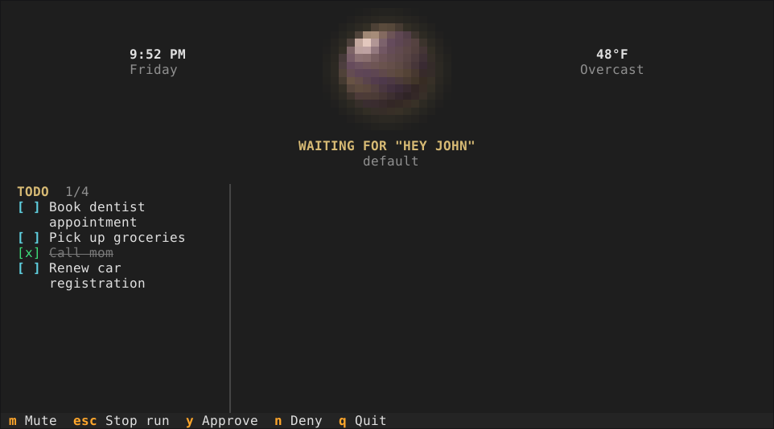

# Hermes Voice

Hermes Voice listens on the microphone, transcribes speech, and sends the text to a Hermes agent at `http://127.0.0.1:8642`. The conversation stays in the terminal. Replies are spoken aloud.



## Setup

Install [Rust](https://rustup.rs) (1.88 or newer) and CMake. Install Hermes with its API server enabled (`API_SERVER_ENABLED=true`).

On Linux, also install the ALSA headers and clang. Debian and Ubuntu: `sudo apt install libasound2-dev clang cmake`.

Create a Gemini API key at [aistudio.google.com/apikey](https://aistudio.google.com/apikey). Set `GEMINI_API_KEY`, or put `GEMINI_API_KEY` in `~/.config/hermes-voice/.env`.

### Wake word

The wake phrase is "hey john". A small model trained for that phrase listens for it on this computer. Train it once with [`training/train_wake_word.ipynb`](training/train_wake_word.ipynb) on Google Colab. Upload the notebook, choose a GPU runtime, and run all cells. It takes about 1.5 hours on Colab Pro, or 3 hours on the free tier. It downloads `hey_john.onnx` at the end. Put that file at `~/.config/hermes-voice/hey_john.onnx`.

To try the app before training, use a ready-made phrase: `--wake "hey jarvis"`, `--wake alexa`, or `--wake "hey mycroft"`. These download on first use and are for personal use only (CC BY-NC-SA 4.0).

## Run

```bash
cargo build --release
target/release/hermes-voice
```

The wake phrase is required. Say "hey john", then the command, in one breath or with a pause. A chime sounds as soon as the phrase is heard. After Hermes finishes speaking, it listens for 2 seconds without the wake phrase, so a follow-up can be said straight away. If no speech starts in that time, it goes back to waiting for the phrase. `--open-mic` sends every utterance and does not use a wake phrase.

When it misses the phrase or wakes by itself, run with `--show-scores`. It prints the wake model's score whenever something sounds partly like the phrase, on screen only. Then set `--wake-threshold` between the scores you see for the phrase and for other talk. The default is `0.5`. `--vad-threshold` is how sure speech detection must be. Its default is also `0.5`.

The Hermes key is read from `HERMES_API_KEY`. If that is unset, it is read from `API_SERVER_KEY` in `$HERMES_HOME/.env`, or `~/.hermes/.env` when `HERMES_HOME` is unset.

`m` mutes the microphone. `esc` cuts speech, and a second press stops the current request. `q` quits.

`--local` transcribes with Whisper on this computer and does not speak replies. It needs no Gemini key.

## Flags

- `--wake` sets the wake phrase. Default `hey john`. The model is read from `~/.config/hermes-voice/<phrase>.onnx`, with spaces as underscores.
- `--open-mic` sends every utterance and skips the wake model.
- `--wake-model` reads the wake model from another file.
- `--wake-threshold` is the score from 0 to 1 that wakes it. Default `0.5`. Lower it when the phrase is missed, raise it when it wakes by itself.
- `--show-scores` prints wake scores while waiting, on screen only.
- `--device` picks an input by index or name. Indexes follow `--list-devices`.
- `--list-devices` prints input devices and exits.
- `--local` transcribes with Whisper and does not speak replies.
- `--stt-model` chooses the transcription model. Default `gemini-3.5-transcribe`, or `small.en` with `--local`.
- `--tts-model` chooses the speech model. Default `gemini-3.8-flash-lite-tts`.
- `--voice` chooses the spoken voice. Default `Kore`.
- `--vad-threshold` is how sure speech detection must be. Default `0.5`. Raise it when room noise shows as hearing.
- `--end-silence-ms` is the pause that ends a phrase. Default `1000`. Raise it when transcripts cut off mid-sentence.

## Privacy

> By default nothing leaves this computer until the wake phrase is heard. While waiting, a small wake word model on this computer listens for the phrase. Once it is heard, the rest of that utterance is sent to Google for transcription, starting 1.5 seconds before the phrase. Earlier talk in the same breath is not sent, and neither is the phrase said alone. If you pause after the phrase, the next utterance is sent. So is speech that starts within 2 seconds of a spoken reply ending. Reply text is sent to Google to be spoken. Transcripts also go to Hermes and its model provider. With `--open-mic`, every utterance is sent. With `--local`, nothing goes to Google.

## Notes

- Local Whisper runs through whisper.cpp with 8-bit (`q8_0`) ggml models. They download on first use to `~/.cache/hermes-voice-rs`. `--stt-model` also accepts a file path.
- Speech detection uses the Silero v6 ONNX model, built into the binary.
- The wake word runs [openWakeWord](https://github.com/dscripka/openWakeWord) models through ONNX Runtime. Its two shared models download on first use to `~/.cache/hermes-voice-rs`. Together with speech detection it uses about 40 MB of memory and a few percent of one Raspberry Pi 4 core.
- On a Raspberry Pi with 1 GB of memory, keep the default Gemini transcription. `--local` loads Whisper `small.en`, which holds about 270 MB and more while it transcribes. If you need `--local` there, `--stt-model base.en` holds about 85 MB.
- Replies show as plain text. Markdown is not rendered. The log shows the newest lines and does not scroll back.

`cargo run --release --example bench -- tests/fixtures/hey_hermes.pcm small.en base.en` loads the models, transcribes the file, and idles 8 s so memory can be sampled.

`cargo run --release --example wake_scores -- ~/.config/hermes-voice/hey_john.onnx clip.pcm` prints the highest wake score in each 16 kHz mono int16 file, and how much CPU time it took. Record a clip on the Pi with `arecord -f S16_LE -r 16000 -c 1 -t raw clip.pcm`.
